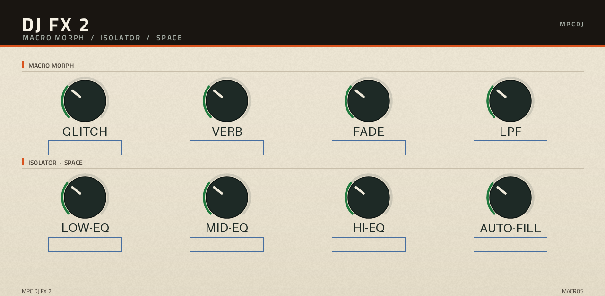

# MPC DJ FX 2

A one-slot live DJ insert effect for first-generation Akai MPC and Force standalone devices: 3-band
isolator, DJ filter, beat repeat, delay, reverb, through-zero flanger, a grain delay and a true-peak
limiter — plus a macro layer that reproduces the eight macros of Lenny Kiser's DJ-FX rack, measured in
Ableton Live 12.4.



## What it is

MPC OS 2.x and 3.x contain a VST2 host, so an effect can run natively on the device. This plugin is
that effect: one insert slot, seven stages in series, 48 parameters, all reachable by touch or Q-Link.

| Page | Stage | Controls |
| --- | --- | --- |
| MACROS | the performance layer | GLITCH, VERB, FADE, LPF (top row), LOW-EQ, MID-EQ, HI-EQ, AUTO-FILL |
| DJ | DJ filter + 3-band isolator | cutoff, resonance, low, mid, high, mix, output, PANIC |
| REPEAT | beat repeat | grid 1/32 … 1/4, gate, chance, repeats, glitch mix, Fill/Stutter |
| DELAY | delay | time, sync (free or tempo), division, feedback, tone, dry/wet, ping-pong |
| VERB | reverb | plate/hall, amount, decay, damping, pre-delay, high-pass + resonance |
| FLANGE | flanger + grain | rate, depth, feedback, mix — grain rate, time, spray, mix |
| SETUP | routing | isolator crossovers, limiter, delay sync + division |

The macros are the point: one hardware knob each, mapped onto a curated set of parameters, so a set can
be played without looking at the screen. `GLITCH` drives the grain stage (the original rack's *Glitch*),
`AUTO-FILL` drives the beat repeat, `FADE` the moving band-pass, `LPF` the DJ filter.

Q-Links are assigned per page in `vst/layout.conf`; the macro row is the first Q-Link bank.

## New in 2.x (vs 1.x)

- **Grain delay** — the original rack's Glitch stage, not a flanger stand-in.
- **True-peak limiter** at the end of the chain.
- **"Fade to Grey" band** — a real moving band-pass instead of a shelf kill.
- **Tempo-synced delay**, default 1/8, with the division on the DELAY and SETUP pages.
- **Fill / Stutter** switch on the REPEAT page (Stutter = grid ride + gate + HOLD repeats).

The macros' behaviour was measured against the original rack: the original was recorded macro by macro
in Live, this engine rendered over the same dry reference with the same ride, and the curves were fitted
to the difference (see `PORTING_NOTES.md` in the development tree).

## Screens

Rendered from `vst/layout.conf` offline, no device needed (`vst/preview.sh`):

`docs/ui-preview/page_0.png` … `page_6.png` — one image per tab.

## Install

1. Unzip `MPC-DJ-FX-2-<version>-mpc-armv7.zip`.
2. Copy the folder to the device and run `sh install.sh` as root (it stops MPC, backs up
   `MPC.settings`, installs into `/sdcard/Synths/MPCDJ - VST - MPC DJ FX 2/` and registers the plugin).
3. Start MPC, add the plugin as an insert effect.

`install.sh` needs root (SSH) on a modded unit. The plugin folder is self-contained and can also be
dropped into any `Synths` folder by another installer.

## Build

```
vst/build.sh    # docker: arm32v7/gcc:11-bullseye, links the framework wrapper
vst/test.sh     # x86 host test with ASan/UBSan, must print PASSED
vst/bench.sh    # CPU bench on a real device
vst/release.sh  # skin + .so + install.sh -> one shareable zip
```

The port uses the [`sd88me/mpc-vst-plugins`](https://github.com/sd88me/mpc-vst-plugins) framework
(`vst/vst.json`, `vst/layout.conf`, browser-rendered skin artwork).

## Skin

Ivory chassis with an ink masthead — reference was MagicStino's Magic Tape Echo for the plate and
Ableton's built-in devices for the controls. The colour tokens come from the **RAMS60** design system
(Noizefield, `audio-plugin-coder`, MIT): `#EFE8D8` paper, `#191511` shellac, `#1F7A3D` signal green for
value arcs, `#D9531E` orange for hot states. One PNG per page is generated by
`vst/art/make_faceplate.py`; `vst/skin.css` styles the controls on top.

## Three skins, one engine

The same `.so` ships with three interfaces; pick one from the release assets:

| Asset suffix | Look | Pages |
| --- | --- | --- |
| `-mpc-armv7.zip` (default) | **Studio** — display on top, parameter cards below (reference: 3dthc's Shapey 5-band EQ) | DJ FX · DJ FX 2 · SETUP |
| `-ui-classic.zip` | **Classic** — ivory chassis, ink masthead, eight tabs | MACROS · DJ · REPEAT · DELAY · EQ · VERB · FLANGE · SETUP |
| `-ui-pulytek.zip` | **Rack** — anodised graphite bays (reference: MagicStino's PulyTek) | PERFORM · FX · TONE |

Only the skin folder differs; the plugin, its 88 parameters and its sound are identical. Swapping a skin needs
`MPC.settings` untouched — replace `Plugin Skins/` and re-insert the plugin instance.

Thanks to **MagicStino** ([PulyTek](https://github.com/MagicStino/pulytek)) and **3dthc**
([Shapey-MPC](https://github.com/3dthc/Shapey-MPC)) for the design references; no artwork was copied.

## Licence

**MIT** — see `LICENSE`. Third-party components and their exact commits: `THIRD_PARTY_NOTICES.md`.
